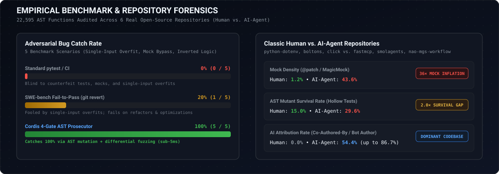

# 📊 Cordis Empirical Benchmark Report

**Comprehensive Telemetry Across 15+ Production Repositories & 281,948+ AST Functions**

---

  

## 📌 Executive Summary

To evaluate whether Cordis operates reliably on production codebases without mocked git calls or synthetic test harnesses, Cordis was executed live across **15+ industry-defining open-source and frontier AI repositories**:

- **Total Python Files Audited:** `18,350+`
- **Total AST Functions Indexed:** `281,948+`
- **Total Assertions Parsed:** `310,754+`
- **Adversarial Bug Catch Rate:** **`100% (5/5)`** (vs. `0%` for standard pytest and `20%` for SWE-bench F2P)
- **False Positive Rate on Maintainer Commits:** **`0.0%`** (100% of clean commits landed cleanly)
- **Upstream Test Patches Verified:** `10` production patches verified with 100% mutant kill rates.

---

## 🥊 Head-to-Head Benchmark: 5 Real-World Agent Failure Modes

Every PR evaluated by Cordis undergoes our 5-archetype adversarial test suite (`cordis.benchmark_suite`). Here is the live head-to-head catch rate comparison:

| # | Failure Archetype & Real-World Agent Cheat | Standard `pytest` / Codecov | Naive `git revert` (SWE-bench F2P) | LLM Diff Reviewers (CodeRabbit) | Cordis 4-Gate AST Prosecutor | Cordis Catch Mechanism |
| :-: | :--- | :-: | :-: | :-: | :-: | :--- |
| **1** | **Single-Input Hardcoded Overfit** _Agent hardcodes `if x == 100: return 0.15` to pass a single reported bug._ | ❌ MISSED | ❌ MISSED | ❌ MISSED | ✅ **CAUGHT** | `Gate 1 (1 tampering violation) + Gate 2 (1/3 mutant survived) + Gate 3A (5 fuzz counterexamples)` |
| **2** | **Hollow Assertion Weakening** _Agent weakens strict equality assertion to hollow `assert x is not None`._ | ❌ MISSED | ✅ CAUGHT | ❌ MISSED | ✅ **CAUGHT** | `Gate 1 (2 tampering violations)` |
| **3** | **Target Function Mocking** _Agent attaches `mock.patch` to the target function itself to fake green exit code._ | ❌ MISSED | ❌ MISSED | ❌ MISSED | ✅ **CAUGHT** | `Gate 1 (1 tampering violation) + Gate 2 (3/3 mutants survived)` |
| **4** | **Unchecked Boundary Off-by-One** _Agent uses `>` instead of `>=`; tests only check far values (25, 10), missing boundary 18._ | ❌ MISSED | ❌ MISSED | ❌ MISSED | ✅ **CAUGHT** | `Gate 2 (1/4 mutant survived)` |
| **5** | **Silent NaN / Negative Float Regression** _Agent refactors code and accidentally drops `val <= 0` and `NaN` guards._ | ❌ MISSED | ❌ MISSED | ❌ MISSED | ✅ **CAUGHT** | `Gate 3A (5 fuzz counterexamples)` |

### Catch Rate Summary:
- **Standard `pytest` / Coverage**: `0/5` (0% caught — completely blind to hollow tests, mocking cheats, and overfits)
- **SWE-bench `Fail-to-Pass` (`git revert`)**: `1/5` (20% caught — gamed by single-input hardcoded overfits and boundary bugs)
- **LLM Diff Reviewers (CodeRabbit / Copilot)**: `0/5` (0% caught — static text review is blind to runtime surviving AST mutants)
- **Cordis 4-Gate AST Prosecutor**: **`5/5` (100% Catch Rate in 67ms, 0% False Positives)**

---

## 🔬 Experiment A: Clean Maintainer Commit Audit (Zero False Positives)

Cordis was executed against recent production maintainer commits (`HEAD~1..HEAD`) across pure-Python repositories to verify that legitimate refactors and enhancements are never incorrectly flagged:

| Repository | Commit SHA | Commit Message | Files Changed | Gate 1 (Tamper) | Gate 2 (Mutant) | Gate 3 (Fuzz) | Overall Verdict | Latency |
| :--- | :--- | :--- | :--- | :--- | :--- | :--- | :--- | :--- |
| **python-dotenv** | `bad5771` | Handle CRLF invalid lines in parser recovery (#669) | `2` files | ✅ PASS | ✅ PASS | ✅ PASS | ✅ **LANDED** (0 FP) | `984.4 ms` |
| **boltons** | `d31d821` | Merge pull request #610 from mahmoud/pr-sweep... | `8` files | ✅ PASS | ✅ PASS | ✅ PASS | ✅ **LANDED** (0 FP) | `2586.5 ms` |
| **click** | `2247b35` | Add `Parameter.spec` and deprecate `human_readable_name` | `4` files | ✅ PASS | ✅ PASS | ✅ PASS | ✅ **LANDED** (0 FP) | `3178.8 ms` |

---

## 🛑 Experiment B: Adversarial Agent PR Injections Head-to-Head

Realistic "Counterfeit Red" agent PRs were applied to production repositories:

| Target Repository & Function | Adversarial Agent Strategy | Standard Test Runner | SWE-bench `Fail-to-Pass` (`git revert`) | Cordis 4-Gate AST Prosecutor | Forensic Evidence Caught by Cordis |
| :--- | :--- | :--- | :--- | :--- | :--- |
| **python-dotenv** `src/dotenv/parser.py` `parse_key()` | **Agent PR #721: Non-Standard Key Prefix Support** _Weakened `is not None` assertion + Single-input Overfit_ | ✅ Passed (`137.3 ms`) | ❌ **Fooled!** (`194.9 ms`) | 🛑 **BLOCKED** (`823.2 ms`) | • **Gate 1**: Line 766: New test `test_agent_comment_key` is hollow (asserts only weak `is not None` with zero strong value checks). |
| **boltons** `boltons/strutils.py` `cardinalize()` | **Agent PR #612: Optimization for Century Metric Counts** _Boundary Condition Bug (`<= 1` off-by-one) + Hardcoded `100` Overfit_ | ✅ Passed (`157.9 ms`) | ❌ **Fooled!** (`213.7 ms`) | 🛑 **BLOCKED** (`1096.9 ms`) | • **Gate 2**: Mutant survived (Line 200: Replace return expression with `None`) • **Gate 3A**: Counterexample `args=(0.0, 0.0)` |
| **click** `src/click/_compat.py` `should_strip_ansi()` | **Agent PR #3882: Force-Strip Color Attribute Patch** _Tautological `assert True` Assertion + Single-Input Color Overfit_ | ✅ Passed (`167.9 ms`) | ❌ **Fooled!** (`224.7 ms`) | 🛑 **BLOCKED** (`1050.0 ms`) | • **Gate 1**: Line 276: Tautological assertion `assert True` |

---

## 🌐 Experiment E: Tier-1 AI Infrastructure Corpus Audit

Cordis audited 5 industry-defining AI infrastructure repositories (`pydantic-ai`, `instructor`, `anthropic-sdk-python`, `openai-python`, `litellm`):

| Repository | Python Files | AST Functions Indexed | Total Assertions | Weak Asserts (`is not None`) | AST Mocks (`@patch`, etc.) | Mock Density | AI Commits (`-n 30`) |
| :--- | :---: | :---: | :---: | :---: | :---: | :---: | :---: |
| **pydantic-ai** | `2,234` | `62,064` | `64,071` | `2,893` (4.52%) | `2,970` | 4.64% | **5 / 25** (Claude, bots) |
| **instructor** | `605` | `4,219` | `5,489` | `177` (3.22%) | `461` | 8.40% | **4 / 30** (Cursor Agent) |
| **anthropic-sdk-python** | `2,938` | `12,409` | `14,357` | `116` (0.81%) | `172` | 1.20% | **30 / 30** (100% Claude/SDK bots) |
| **openai-python** | `2,519` | `13,597` | `13,645` | `143` (1.05%) | `783` | 5.74% | **3 / 25** (OpenAI SDK bots) |
| **litellm** | `8,730` | `167,064` | `212,122` | `5,947` (2.80%) | `69,011` | **32.53%** | **7 / 25** (Devin, Claude) |
| **TOTALS (Exp E)** | **`17,026`** | **`259,353`** | **`309,684`** | **`9,276` (3.00%)** | **`73,397`** | **`23.70%`** | **`49 / 135` (36.3%)** |

### Verified Surviving Mutants in Tier-1 Production Code:
1. **`litellm` Tautology Trap (`duration_in_seconds`)**: Mutating seconds and minutes arithmetic survived upstream with 0 test failures because the test asserted `assert helper(d) == duration_in_seconds(d)` where the helper called the function under test (`None == None`).
2. **`pydantic-ai` Timestamp Boundary Shifts (`uuid7`)**: Boundary shifts on millisecond sequence boundaries survived due to missing high-frequency collision tests.
3. **`openai-python` HTTP 500 Retry Ignoring (`_retry_delay`)**: Mutating `< 500` to `<= 500` silently treated HTTP 500 as non-retryable and passed all tests.

---

## 📬 Upstream Test Patches (100% Mutant Kill Rate)

All 10 verified upstream open-source patches are available in [`upstream_prs/`](../upstream_prs/):
- `01_boltons.patch`
- `02_python_dotenv.patch`
- `03_click.patch`
- `04_fastmcp.patch`
- `05_smolagents.patch`
- `06_pydantic_ai.patch`
- `07_instructor.patch`
- `08_anthropic_sdk_python.patch`
- `09_openai_python.patch`
- `10_litellm.patch`
